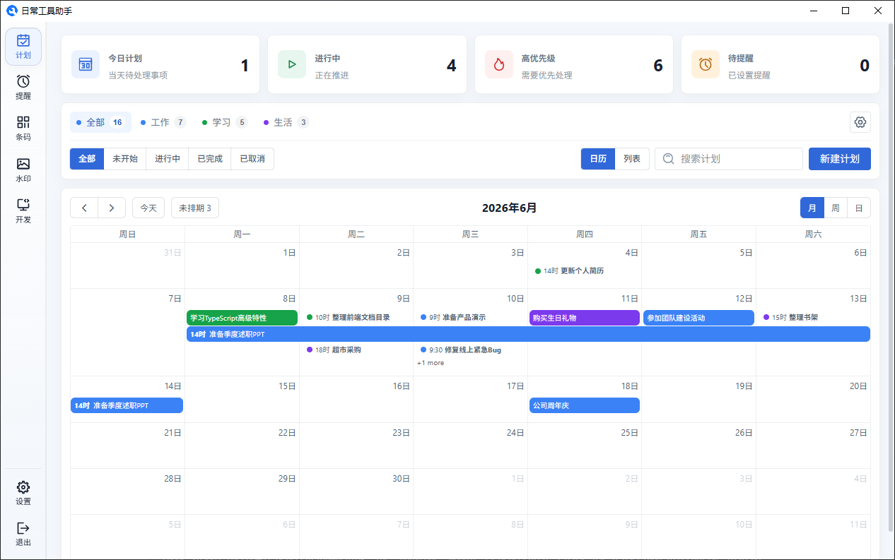
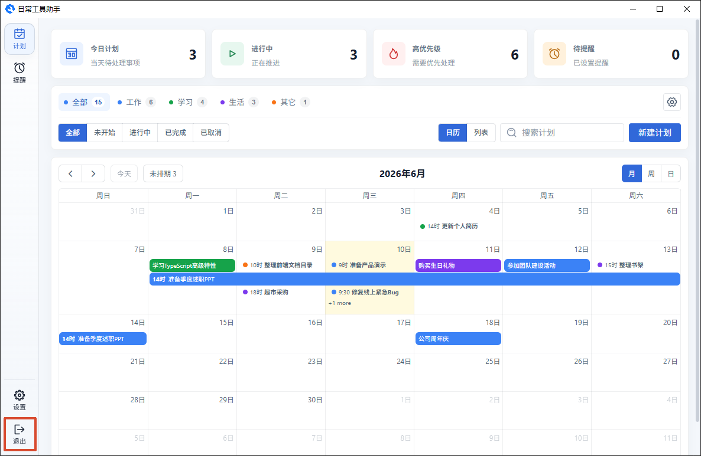
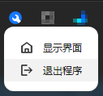
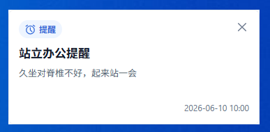

# 日常工具助手

日常工具助手是一款桌面效率工具，帮你管理**计划任务**和**定时提醒**，还内置条码生成识别、图片水印和数据库工作台等实用工具，让日常工作生活更有条理。

---

## 目录

1. [快速开始](#1-快速开始)
2. [计划管理](./docs/plan.md)
3. [提醒管理](./docs/reminder.md)
4. [条码管理](./docs/barcode.md)
5. [图片水印](./docs/watermark.md)
6. [数据库](./docs/database.md)
7. [通知弹窗](#7-通知弹窗)
8. [设置](./docs/settings.md)
9. [更新日志](./CHANGELOG.md)
10. [常见问题](#10-常见问题)

---

## 1. 快速开始

### 下载地址

https://github.com/zcrkey/tool-helper-updater/releases

### 安装与启动

下载安装包完成安装后，双击桌面图标启动应用。

应用启动后会在**系统托盘**（屏幕右下角）显示图标。

关闭窗口只是隐藏界面，应用仍在后台运行。需要彻底退出时，有以下两种方式：

- 在主界面左下角点击"退出"按钮

  

- 右键托盘图标选择"退出程序"

  

## 2. 计划管理

管理日常待办事项，支持日历和列表两种视图，可按分类整理、按优先级标记，并能为计划设置提醒时间。

[查看计划管理详细文档](./docs/plan.md)

## 3. 提醒管理

到时间自动弹窗通知你的事项，支持一次性、每天、每周、每月四种重复规则，以及短暂、常驻、紧急三种通知模式。

[查看提醒管理详细文档](./docs/reminder.md)

## 4. 条码管理

离线生成和识别 QR Code、Code 128，支持样式模板、Logo、颜色渐变等丰富配置，并提供历史记录复用。

[查看条码管理详细文档](./docs/barcode.md)

## 5. 图片水印

在本地给图片添加文字或 Logo 水印，支持图片裁剪旋转、九宫格定位、满屏平铺防盗图和多种样式效果。

[查看图片水印详细文档](./docs/watermark.md)

## 6. 数据库

面向开发的本地数据库工作台，支持连接 PostgreSQL 和 MySQL，完成 SQL 查询、数据编辑、表结构设计、ER 图、结构同步和备份还原。

[查看数据库详细文档](./docs/database.md)

## 7. 通知弹窗

提醒触发时，屏幕右下角会弹出一个通知窗口：

弹窗的交互方式：

| 操作                   | 效果                           |
| ---------------------- | ------------------------------ |
| 点击内容区域           | 跳转到对应的详情页查看完整信息 |
| 点击右上角 ✕           | 关闭弹窗                       |
| 什么都不做（短暂提醒） | 约 12 秒后自动消失             |

提醒触发时，任务栏的应用图标也会闪烁，吸引你注意。

## 8. 设置

支持主题切换（跟随系统 / 浅色 / 深色）、开机自启、数据导出导入与云盘同步、自动更新。

[查看设置详细文档](./docs/settings.md)

## 9. 更新日志

[点击查看更新日志](./CHANGELOG.md)

## 10. 常见问题

**问：我关了窗口，但应用还在？**

这是正常设计。关闭窗口只是隐藏界面，应用仍在后台运行。需要彻底退出时，有以下两种方式：

- 在主界面左下角点击"退出"按钮
- 右键托盘图标选择"退出程序"

**问：到时间了提醒没有弹出来？**

请检查：

1. 提醒状态是否为"启用中"
2. 下次触发时间是否正确

**问：我的数据安全吗？**

所有数据存储在本地电脑上，不会自动上传到任何云端。你可以手动导出备份文件存到安全位置。
