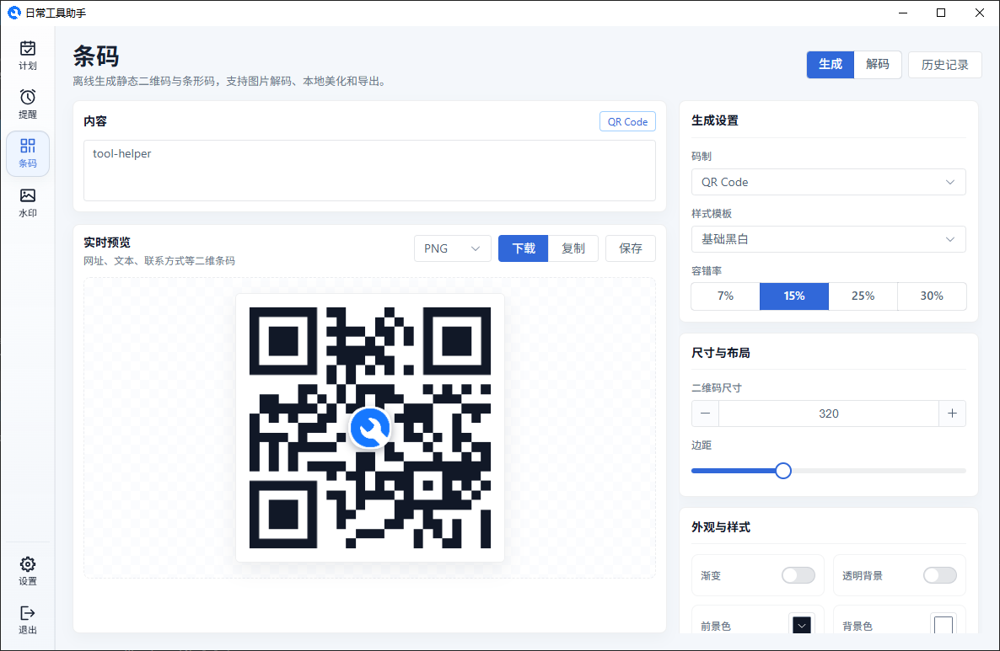
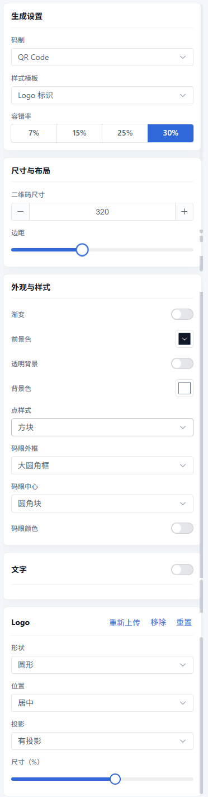
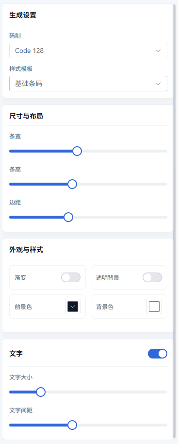
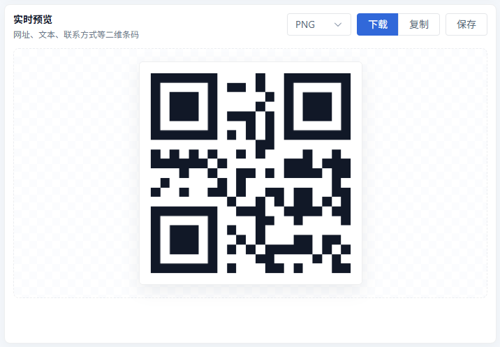
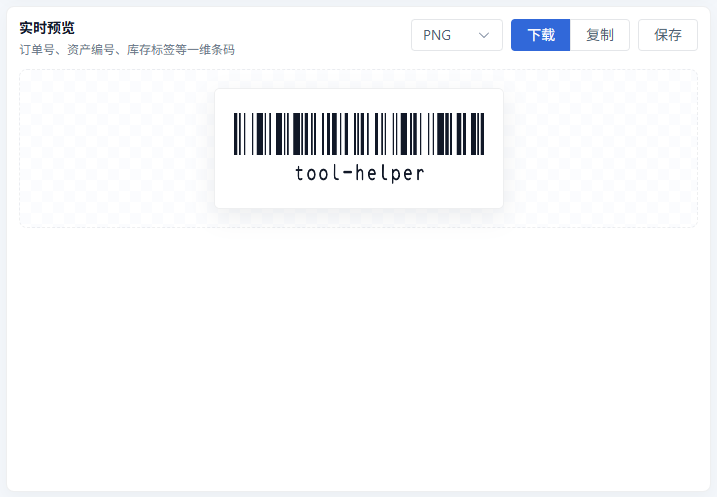
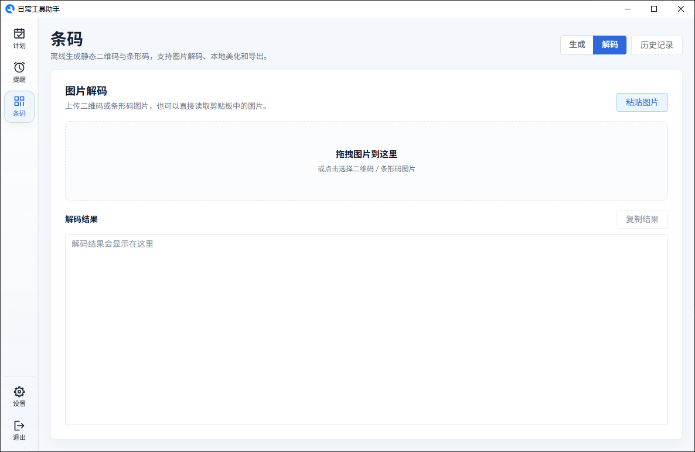
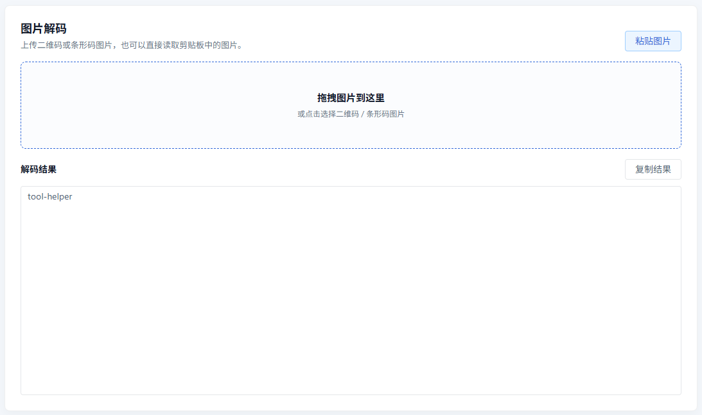
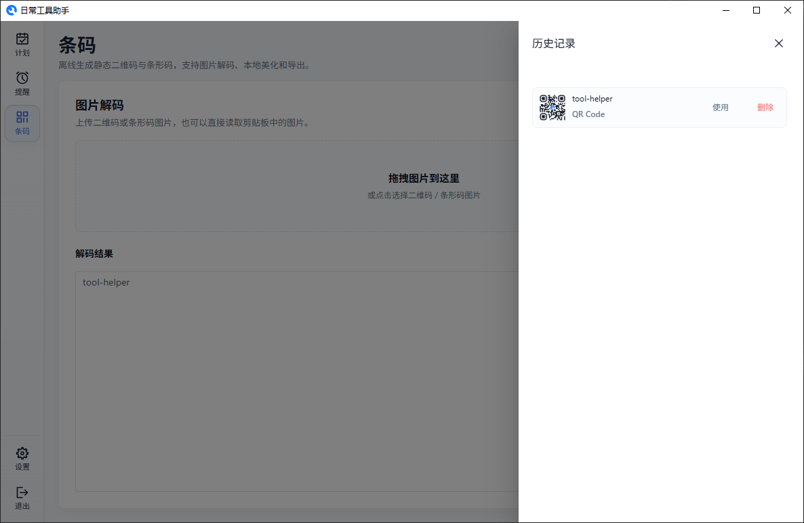

# 条码管理

条码页用于离线生成和识别常用静态码，当前支持 **QR Code** 和 **Code 128**。所有内容、Logo 和图片都只在本地处理，不会上传到云端。

条码管理分为两个模式：

- **生成** — 输入内容后实时生成二维码或条形码，可调整样式并导出图片
- **解码** — 上传、拖拽或粘贴图片，识别其中的二维码或条形码内容

## 生成条码

在"生成"模式中，左侧是内容输入和实时预览，右侧是参数面板。

生成 QR Code 时可以配置：

- **码制** — 当前支持 QR Code 和 Code 128
- **样式模板** — 选择基础黑白、简单标签、Logo 标识、圆点、圆角、渐变颜色等预设
- **二维码尺寸** — 控制生成图片的实际尺寸
- **边距** — 控制码图四周留白
- **颜色样式** — 设置前景色、背景色、透明背景和渐变
- **码点与码眼** — 设置码点形状、码眼外框、码眼中心和码眼颜色
- **容错率** — 控制二维码被遮挡或污损后的识别能力
- **Logo** — 上传本地 Logo，并设置形状、位置、投影和尺寸
- **文字说明** — 在二维码下方显示自定义说明文字

生成 Code 128 时可以配置：

- **条宽** — 控制条码线条宽度
- **条高** — 控制条码整体高度
- **边距** — 控制条码四周留白
- **显示文字** — 控制是否在条码下方显示原始内容
- **文字大小** — 调整条码文字字号
- **文字间距** — 调整文字和条码之间的距离

实时预览区域支持：

- **导出 PNG / JPG** — 将当前生成结果保存为图片
- **复制图片** — 将当前生成结果复制到剪贴板
- **保存记录** — 将当前内容、码制和样式配置保存到历史记录

## 解码图片

切换到"解码"模式后，可以识别本地图片中的二维码或条形码。

支持三种图片输入方式：

- **拖拽图片** — 将图片直接拖入上传区域
- **选择图片** — 点击上传区域，从本地选择图片
- **粘贴图片** — 从剪贴板读取图片并自动识别

识别成功后，结果会显示在解码结果框中，可以一键复制结果内容。

## 历史记录

点击页面右上角的"历史记录"按钮，可以打开历史记录抽屉。

历史记录中可以：

- **使用** — 将历史记录中的内容和样式配置回填到当前工作台
- **删除** — 移除不再需要的历史记录

历史记录适合保存常用设备码、活动码、资产编号、订单号等固定内容，后续可以快速复用。

---

[返回主文档](../README.md)
