# 数据库

数据库页是一个面向开发的本地数据库工作台，支持连接 **PostgreSQL** 和 **MySQL**，在一个界面里完成 SQL 查询、数据编辑、表结构管理、ER 图、结构同步和备份还原。

所有连接配置只保存在本地，连接密码通过系统级加密存储（Windows 凭据管理器），不会明文落盘，也不会上传到任何云端。

## 管理连接

左侧"连接与对象"面板管理所有数据库连接，点击右上角"+"新建连接。

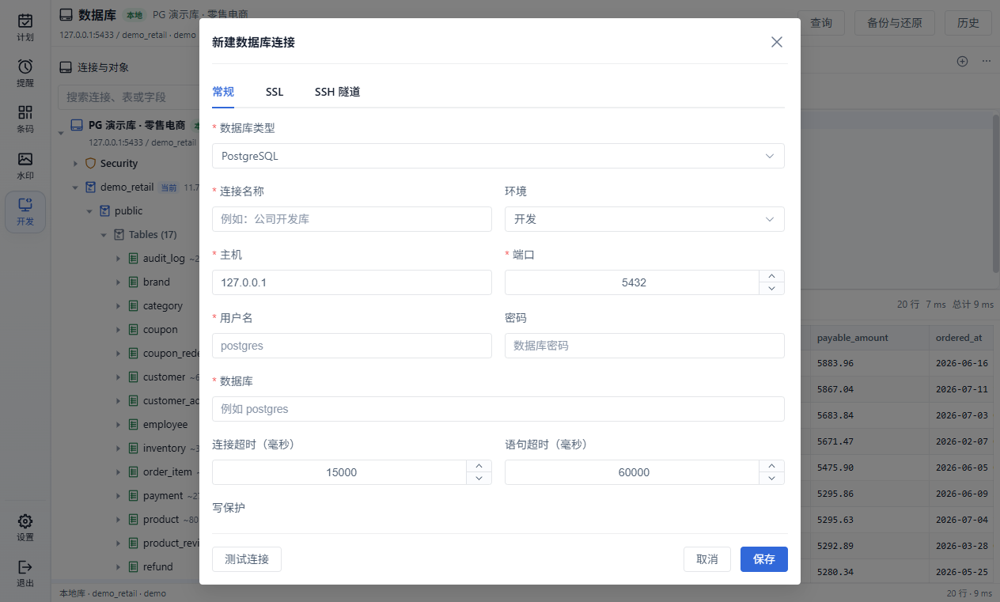

- **数据库类型** — PostgreSQL 或 MySQL
- **连接名称 / 环境** — 环境分为本地、开发、生产，侧边栏会用不同颜色的徽标区分
- **主机 / 端口 / 用户名 / 密码 / 数据库** — 基础连接信息
- **写保护** — 开启后该连接默认只读，可随时解锁；生产环境连接会强制只读
- **SSL** — 支持 sslmode 与 CA 证书、客户端证书、私钥
- **SSH 隧道** — 支持密码或私钥两种认证方式，可先查看主机指纹再信任

填写完成后可以先用"测试连接"验证，再点击"保存"。连接支持排序、编辑、断开和删除。

## 对象树

连接展开后按 **数据库 → Schema → 表 / 视图 / 序列 / 类型 / 函数** 分层展示，表节点会显示行数估算，数据库节点会显示大小。顶部搜索框可以快速过滤连接、表和字段。

MySQL 连接的用法完全一致：

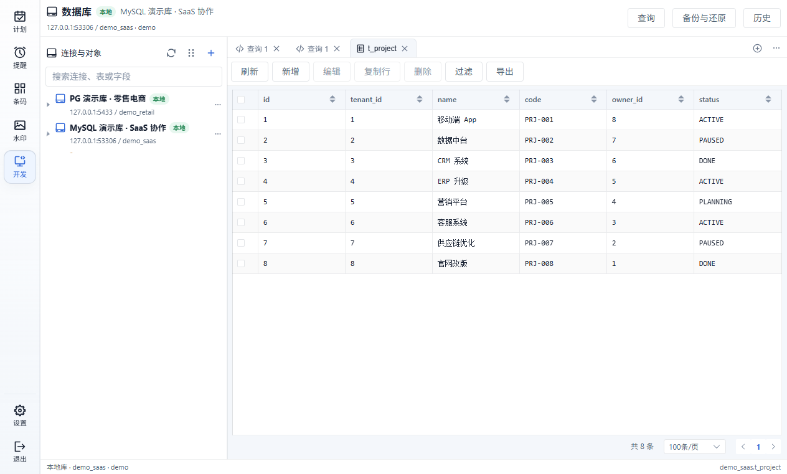

树节点右侧的"···"菜单提供常用操作：

| 节点 | 菜单项 |
| ---- | ------ |
| 连接 | 刷新、新建查询、测试连接、编辑连接、断开连接、新建 Schema、数据库信息、删除连接 |
| Schema | 新建表、新建查询、结构同步、备份 Schema、ER 图 |
| 表 | 打开数据、新建查询、导出数据、设计表、备份表、清空表、删除表 |
| 视图 | 打开数据、新建查询、导出数据 |

"Security"节点可以查看当前连接的用户与角色权限。

## SQL 查询

点击顶部"查询"按钮或对象树菜单里的"新建查询"打开查询标签页，可以同时开多个。

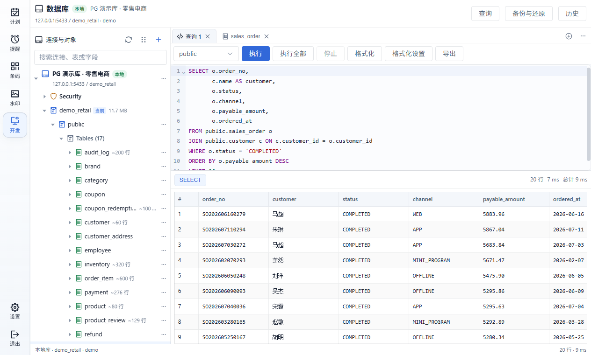

- **智能补全** — 基于 Schema 元数据补全表名、列名、函数和 SQL 片段，跨 Schema 对象也能补全
- **语法提示** — 悬停查看列类型和函数说明，写错语法会即时标红
- **格式化** — 支持自定义缩进、关键字大小写等格式化设置
- **默认 Schema** — 通过下拉切换当前 Schema，不用在 SQL 里写前缀
- **执行** — 支持"执行"（当前语句）、"执行全部"和"停止"
- **结果区** — 显示行数与耗时，结果可排序、可导出

## 数据编辑

在对象树点击表即可打开数据网格，直接浏览和编辑表数据。

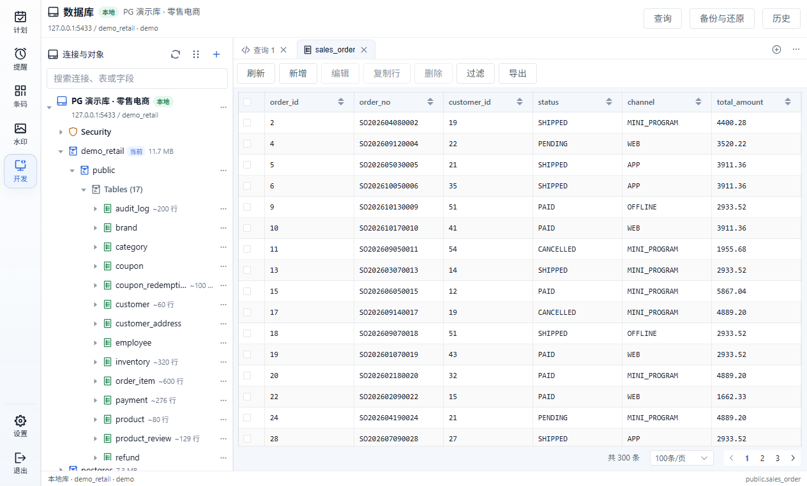

- **新增 / 编辑 / 复制行 / 删除** — 按行操作，修改即时保存
- **类型化控件** — 数字、布尔、时间等字段使用对应的输入控件，NULL 与空值明确区分
- **过滤** — 按条件筛选数据
- **导出** — 把当前表数据导出为文件
- **分页** — 底部显示总行数，可切换每页条数

## 表设计器

表菜单里的"设计表"可以查看和修改表结构。

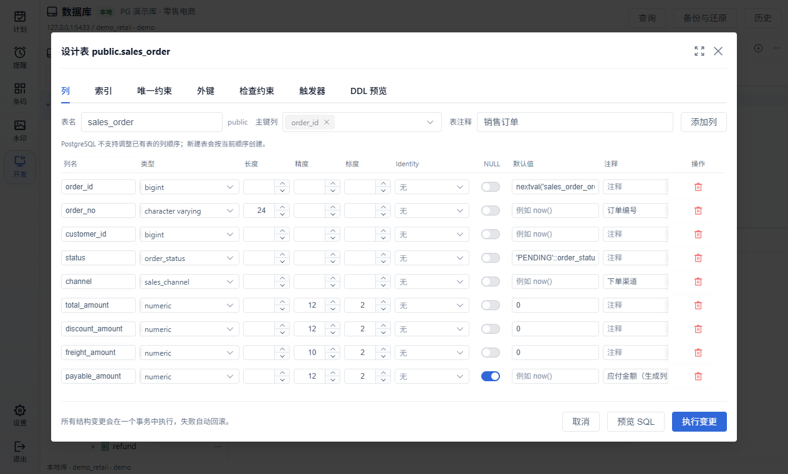

- 页签覆盖 **列、索引、唯一约束、外键、检查约束、触发器**，并可随时切换"DDL 预览"
- 可以编辑列名、类型、长度精度、默认值、是否可空和注释
- 所有结构变更汇总为 SQL，在一个事务里执行，失败自动回滚；执行前可"预览 SQL"

## ER 图

Schema 菜单里的"ER 图"用关系图展示表之间的主外键关系。

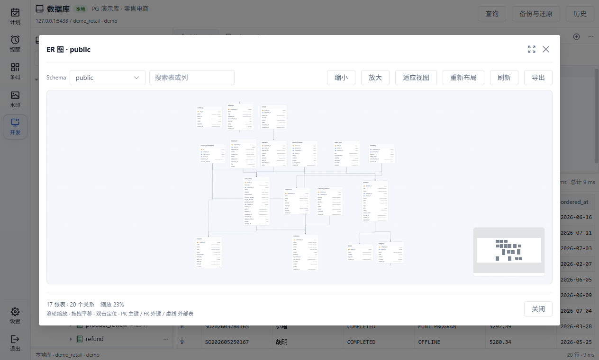

- 实体卡片显示列、主键和外键，连线表示关联关系
- 支持**缩小 / 放大 / 适应视图 / 重新布局**，可按表名搜索过滤
- 滚轮缩放、拖拽平移，双击实体可定位表；支持导出图片

## 结构同步

Schema 菜单里的"结构同步"用于比较两个 Schema 的差异并生成同步 SQL，常用于开发库 → 测试库的结构升级。

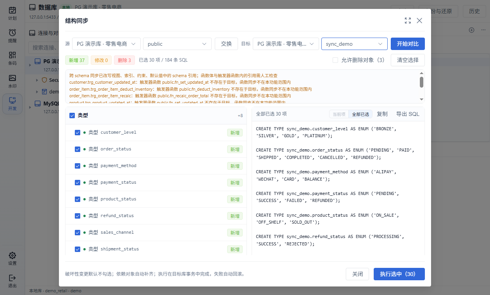

- 源和目标可以是不同连接、不同 Schema，也可以点击"交换"互换方向
- 对比范围包括**类型、序列、表、列、索引、约束、触发器与视图**
- 差异分为新增 / 修改 / 删除三类，勾选后可查看每条 SQL
- **破坏性变更（删除对象）默认不勾选**，需要手动开启"允许删除对象"
- 依赖对象（外键引用的类型、序列等）会自动补齐，避免执行失败
- 全部变更在目标库一个事务里完成，失败自动回滚；也可以只"导出 SQL"手工执行

## 数据导出

表、视图和查询结果都可以导出：

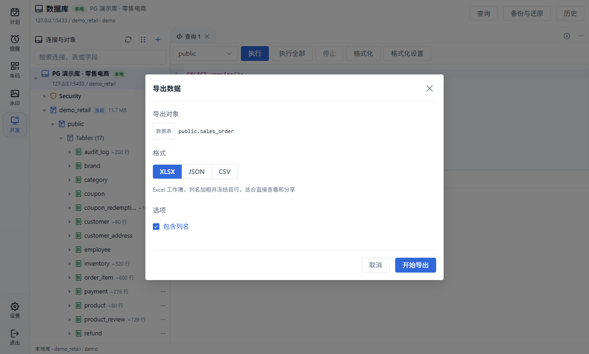

- **格式** — XLSX、JSON、CSV
- **包含列名** — 首行输出字段名，方便直接用 Excel 查看

## 备份与还原

顶部"备份与还原"打开双页签弹层，覆盖库级备份和恢复。

**备份：**

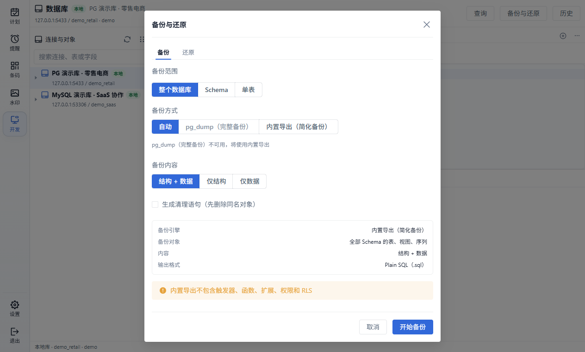

- **备份范围** — 整个数据库、指定 Schema 或单表
- **备份方式** — 自动优先使用 pg_dump / mysqldump 生成完整备份，工具不可用时降级为内置导出（简化备份）
- **备份内容** — 结构 + 数据、仅结构或仅数据，可选生成清理语句（先删除同名对象）
- 输出为 Plain SQL 文件，面板会显示备份引擎、备份对象和格式摘要

**还原：**

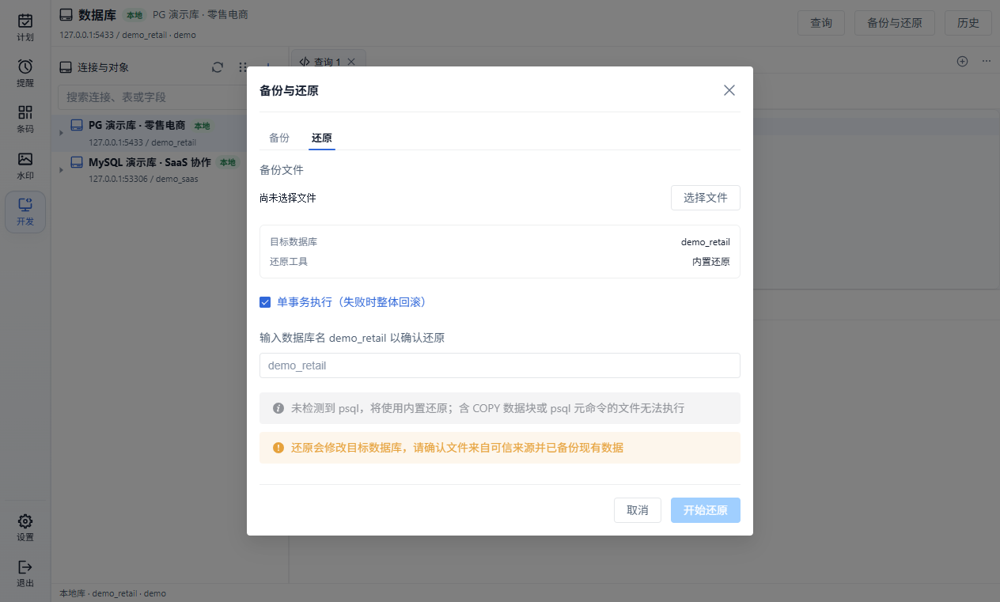

- 选择备份文件后确认目标数据库，输入数据库名二次确认
- 默认**单事务执行**，失败整体回滚
- 内置导出的简化备份**不包含触发器、函数、扩展、权限和 RLS**，界面会明确提示；需要完整备份时请安装 pg_dump / mysqldump

## 数据库信息与查询历史

**数据库信息** 展示库大小、表数量、Schema 数量，以及每个表的数据大小、索引大小和估算行数：

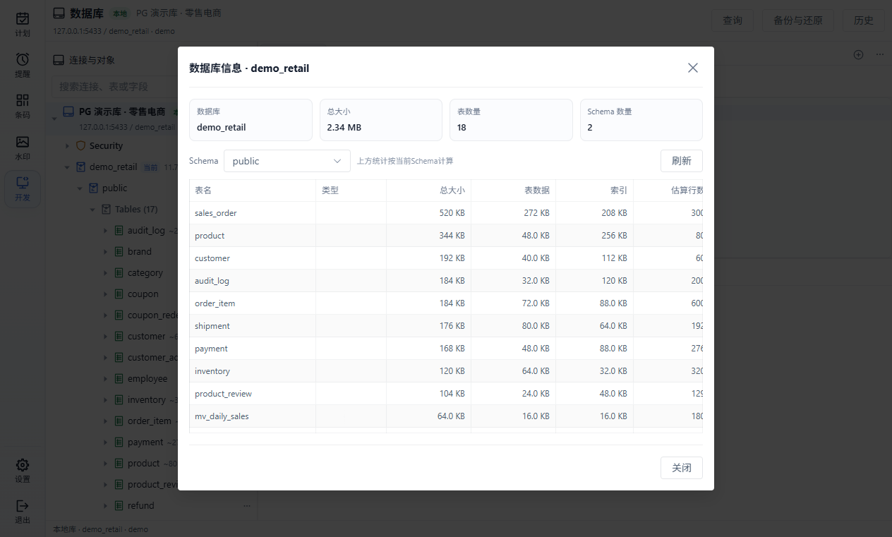

**查询历史** 记录每次执行的 SQL、状态、耗时和行数，可复制、刷新和清空：

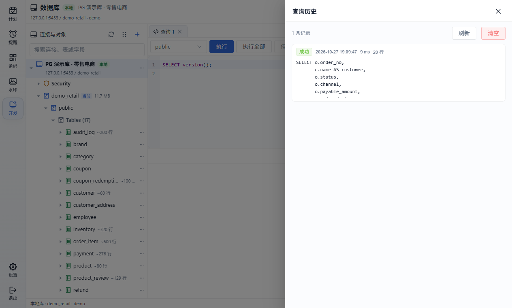

---

[返回主文档](../README.md)
