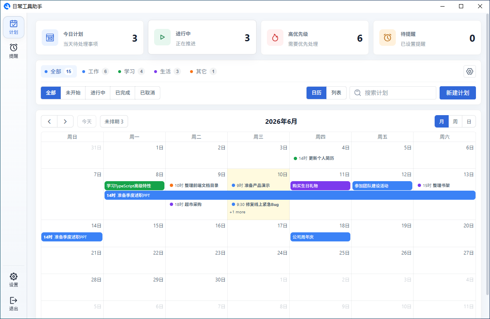
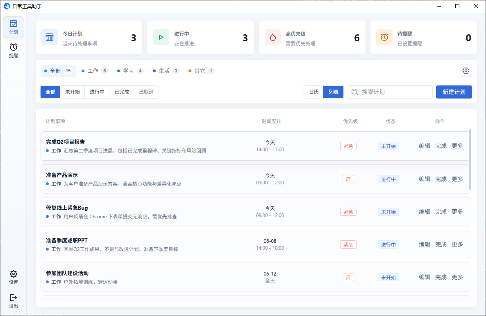
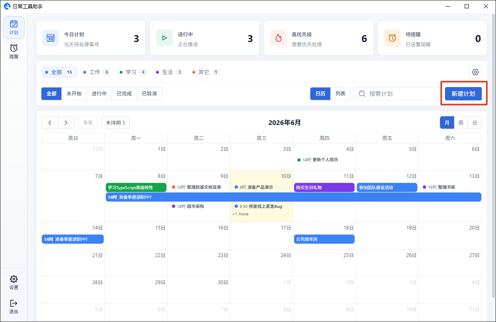
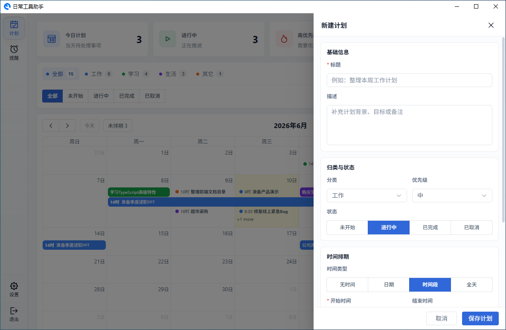
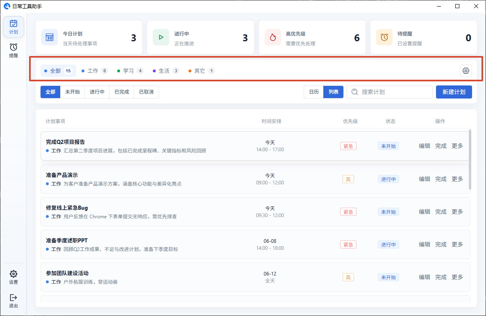
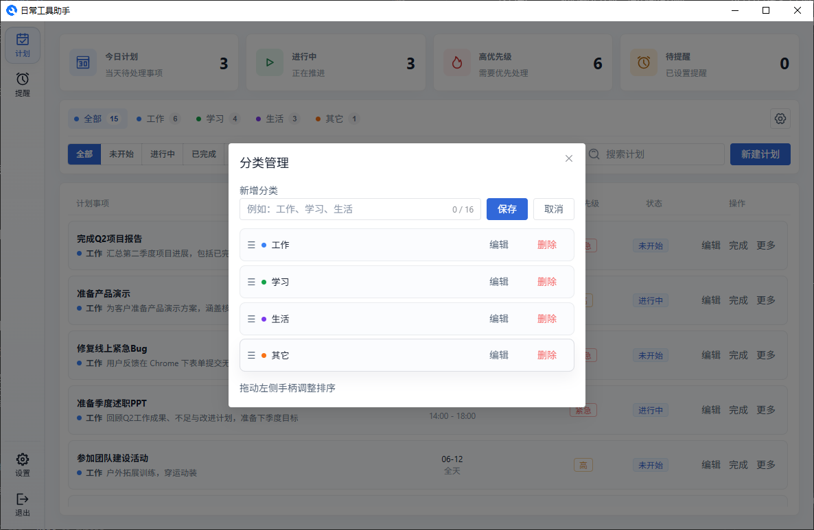

# 计划管理

计划页是管理日常待办事项的核心，分为**日历**和**列表**两种视图。

## 新建计划

点击页面右上角的"新建计划"按钮，在弹出的抽屉中填写：

- **标题** — 计划要做的事情
- **描述** — 补充说明或备注
- **分类** — 归到某个分类下，方便筛选
- **优先级** — 标记事项的重要程度（无、低、中、高、紧急）
- **时间类型** — 选择该计划是否有具体时间
- **开始/结束时间** — 根据时间类型填入
- **提醒时间** — 设置后到点会弹窗通知你

**时间类型说明：**

| 类型       | 用法                             | 示例                       |
| ---------- | -------------------------------- | -------------------------- |
| 无时间     | 只是一个待办，不占用日历时段     | "读《设计模式》"           |
| 仅日期     | 知道哪天要做，但不固定几点       | "6月11日购买生日礼物"      |
| 具体时间段 | 有明确的起止时间                 | "14:00-17:00 完成项目报告" |
| 全天事项   | 占用一整天，日历中显示为全天色块 | "6月12日团建活动"          |

## 优先级

| 优先级 | 什么时候用                 |
| ------ | -------------------------- |
| 无     | 日常琐事、可做可不做的事   |
| 低     | 不着急，有空再处理         |
| 中     | 常规工作任务               |
| 高     | 重要、有 deadline 压力     |
| 紧急   | 需要马上处理的（截止迫近） |

## 查看详情

计划提醒弹窗弹出后，点击弹窗任意位置会打开应用内的"计划详情"弹窗：

- 展示分类、状态、优先级、时间安排、截止时间、提醒时间、创建/完成时间和计划描述
- 点击"编辑"可以直接进入编辑抽屉修改计划

## 分类管理

在计划页顶部可以管理分类。你可以新增、重命名、排序或删除分类。每个计划只能归到一个分类下。

---

[返回主文档](../README.md)
