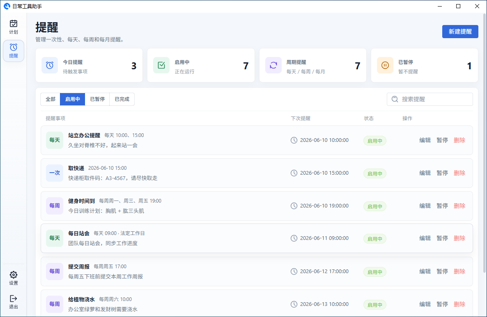
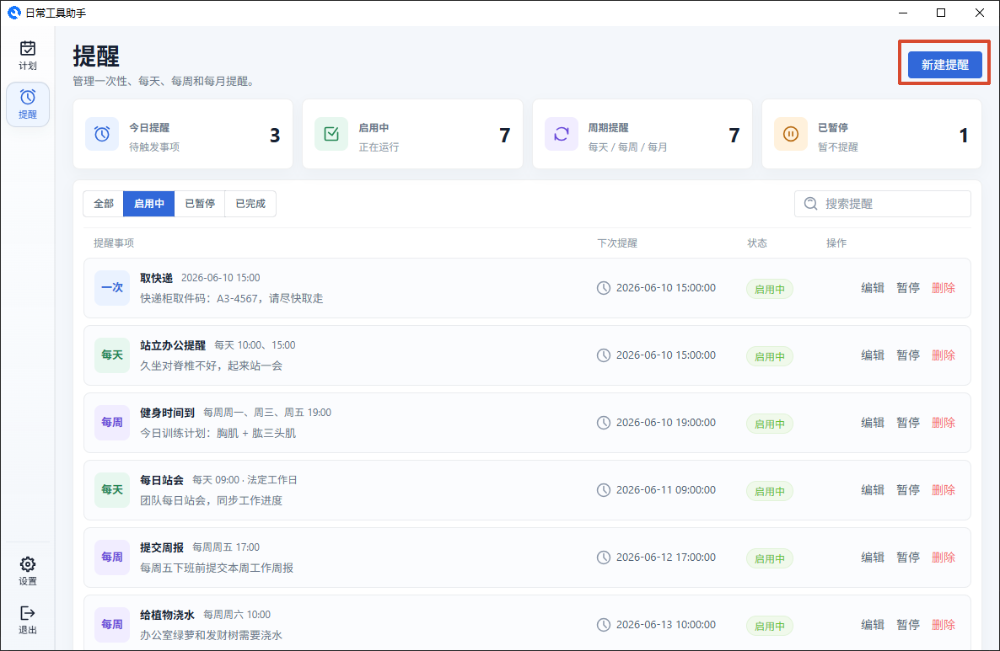
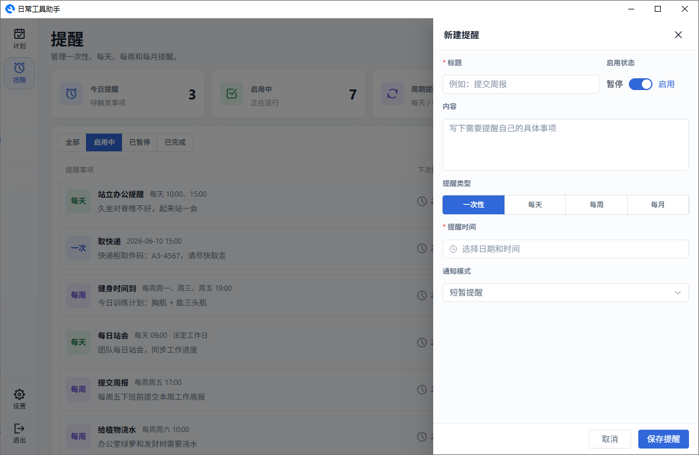
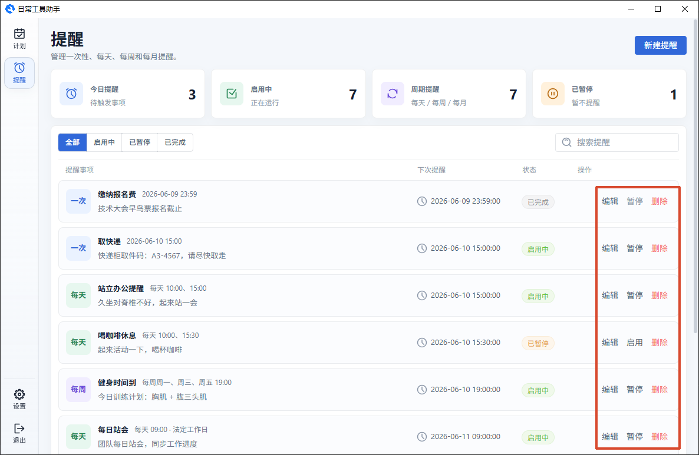

# 提醒管理

提醒是到时间自动弹窗通知你的事项。相比计划中的提醒，它更灵活，支持多种重复规则。

## 新建提醒

点击"新建提醒"，在抽屉中填写：

- **标题** — 提醒的内容
- **启用状态** — 开启后到点才会触发，临时不需要可以"暂停"
- **内容** — 更详细的说明
- **提醒类型** — 选择触发方式（一次性、每天、每周、每月）
- **提醒时间** — 根据类型填入具体时间
- **通知模式** — 弹窗的行为方式（短暂提醒、常驻提醒、紧急提醒）

## 提醒类型

| 类型   | 适合场景                       | 如何设置时间       |
| ------ | ------------------------------ | ------------------ |
| 一次性 | 取快递、交报名费等只提醒一次的 | 选具体日期和时间   |
| 每天   | 每日站会、吃药等每天固定时间   | 选一个或多个时间点 |
| 每周   | 周报、健身等每周固定几天       | 选星期几 + 时间点  |
| 每月   | 月度总结、缴费等每月固定日期   | 选几号 + 时间点    |

## 通知模式

这是提醒弹窗的"脾气"——决定它怎么出现在你面前：

| 模式         | 弹窗表现                              | 适合用来             |
| ------------ | ------------------------------------- | -------------------- |
| **短暂提醒** | 右下角出现，几秒后自动消失            | 一般提醒，看到就行   |
| **常驻提醒** | 右下角出现，不消失直到你手动关        | 需要你确认的重要事项 |
| **紧急提醒** | 右下角出现 + 自动把应用窗口弹到最前面 | 开会等必须立即响应的 |

## 查看详情

提醒弹窗停留在屏幕右下角时，点击弹窗任意位置（或右下角的"查看详情 ›"）会打开应用内的"提醒详情"弹窗：

- 展示提醒类型、状态、提醒规则、下次提醒、最近触发、通知方式、创建时间和提醒内容
- 点击"编辑"可以直接进入编辑抽屉修改提醒

## 列表操作

提醒列表中的每一条都可以：

- **编辑** — 修改提醒内容
- **启用/暂停** — 临时开关，不影响已设置的数据
- **删除** — 彻底移除

---

[返回主文档](../README.md)
