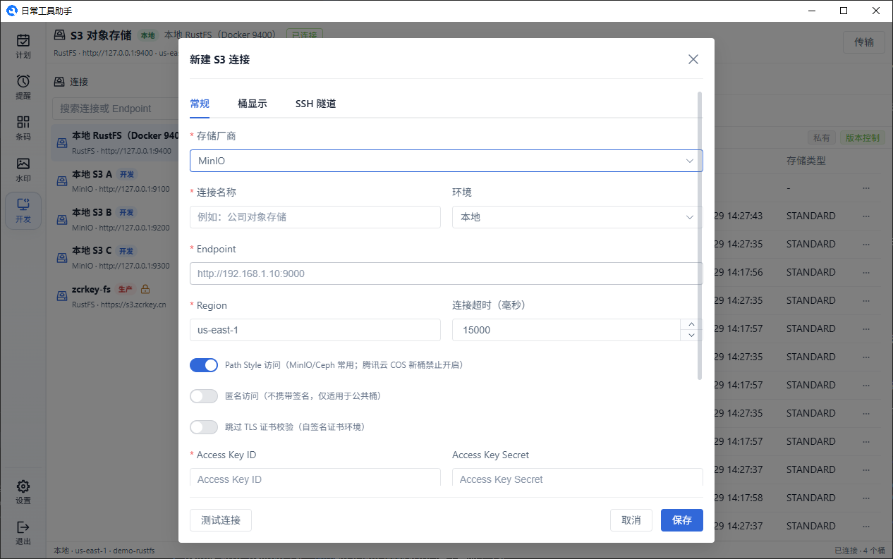
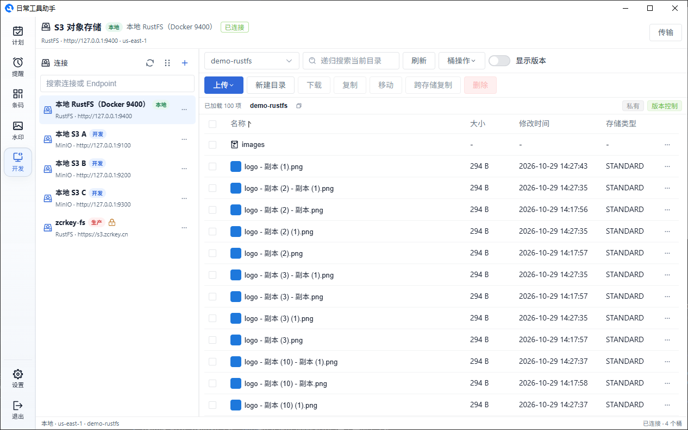
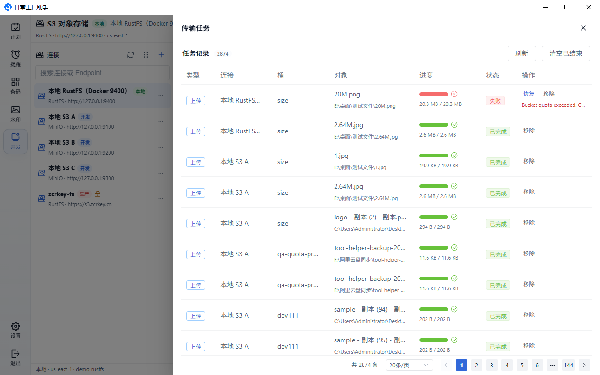

# 对象存储（S3）

S3 页是一个 S3 兼容对象存储工作台，可以直接连接 **AWS S3、阿里云 OSS、腾讯云 COS、七牛云、MinIO、RustFS、Ceph RGW、Cloudflare R2** 以及任意自建 S3 兼容服务，完成浏览、上传下载、版本管理、桶配置和传输任务管理。

所有连接配置与 AccessKey 只保存在本地，密钥通过系统级加密存储；进入数据库或 S3 模块前必须先设置主密码，空闲超时后会重新锁定（`Ctrl+Alt+L` 可手动锁定）。主密码的设置、自动锁定时长和忘记重置见[设置文档](./settings.md#安全)。

## 管理连接

左侧"连接"面板管理所有对象存储连接，点击右上角"+"新建连接。

- **厂商预设** — 选择厂商后自动填充 Endpoint、Region、Path Style 等默认值，能力位（版本控制、ACL、生命周期等）随厂商自动适配
- **环境** — 本地 / 开发 / 生产，生产环境强制只读
- **Endpoint / Region / Path Style / 连接超时 / 跳过 TLS 校验** — 兼容各类私有化部署
- **显示桶** — 支持跳过 ListBuckets、手填默认桶与手动桶，适配只能访问指定桶的受限账号
- **匿名访问** — 无凭据访问公开桶
- **SSH 隧道** — 支持密码或私钥认证，先确认主机指纹再信任；隧道内仍按真实域名校验证书，Host/SNI/签名不受影响
- **写保护** — 默认只读，需要显式解锁才能修改

保存前可以先"测试连接"，连接支持排序、编辑、断开和删除。切换连接或桶时，正在运行的后台传输不会被中断。

主密码未解锁时，编辑已有连接看到的已保存 AccessKey Secret、Session Token、SSH 密码和私钥口令会处于锁定状态，点击"解锁主密码查看"后才能查看或修改；留空表示不修改原有凭据。

## 浏览对象

- **前缀导航** — 面包屑逐级进入目录，底部路径条显示 `桶/前缀`，点击复制图标即可复制完整路径
- **分页加载** — 滚动到底部继续加载；搜索支持继续加载，不再有固定条数上限
- **搜索** — 在当前前缀下递归匹配对象名
- **排序** — 支持按名称、大小、修改时间对已加载结果排序
- **缩略图** — 图片对象显示缩略图，支持 WebP 等格式
- **拖拽上传** — 直接拖入文件或目录即可上传
- **桶状态** — 右侧徽标显示桶的公开/私有、版本控制、加密、CORS 状态，点击进入桶设置

**显示版本** 开关打开后，列表切换为版本视图：文件夹、对象版本和删除标记统一展示，可翻页，也可下载指定版本、恢复为当前、复制版本 ID、生成版本临时链接、批量删除旧版本。`null` 是合法的未编号版本，不会被隐藏。

## 对象操作

选中对象后工具栏提供：

| 操作        | 说明                                     |
| ----------- | ---------------------------------------- |
| 上传        | 上传文件，或选择文件夹整目录上传         |
| 新建目录    | 创建目录占位对象                         |
| 重命名      | 仅文件支持                               |
| 下载        | 文件或多选目录递归下载，保持完整前缀结构 |
| 复制 / 移动 | 支持多选文件与目录，可选目标桶与目标目录 |
| 跨连接复制  | 复制到另一个连接的桶                     |
| 删除        | 批量删除，目录递归删除                   |

对象详情分为 **预览 / 信息 / 版本 / 标签 / 权限 / 预签名** 页签：

- 预览支持图片、视频、音频、PDF 和文本（JSON 自动格式化，超大文本截断提示）
- 信息页可编辑自定义元数据、Content-Type 和存储类别
- 标签页可增删键值对，清空即删除全部标签
- 权限页可应用对象 ACL，并展示当前授权列表
- 公开桶额外展示可直接访问的公开地址
- 预签名支持 GET/PUT、有效期选择，并提示预签名地址直接指向真实 Endpoint

## 上传与传输

上传直接从工具栏发起（上传文件 / 上传文件夹），不会先弹选项页。只有真的遇到同名对象时，才会弹出一次处理选择：**覆盖 / 跳过 / 自动重命名**，整批统一应用；没有冲突就直接开始上传。存储类别可在上传后的对象详情里修改。

传输任务显示在顶部"传输"抽屉中，包含上传、下载、跨连接复制。上传/下载提交成功只更新任务列表，不会自动打开抽屉；只有失败或部分跳过时才弹出结果明细。

- 分片上传与断点续传，暂停、继续、取消
- 下载使用 Range 断点续传，任务记录 ETag 与修改时间，避免文件变化后拼接出错误内容
- 任务持久化保存，应用重启后仍可恢复
- 断开连接或删除连接时，如果有运行中的任务会提示暂停、取消或直接继续

分片大小、并发数、重试次数在"设置 → S3 传输"中调整（默认 8 MiB / 3 并发 / 2 次重试），只对新任务生效；暂停恢复的任务沿用创建时的参数。超大文件会自动增大分片，以满足 10000 片的上传限制。

## 桶设置

桶设置左侧为分类导航，按厂商能力自动隐藏不支持的项：

- **版本控制** — 启用 / 暂停
- **用量与配额** — 当前对象数量与容量（可标记部分扫描），MinIO 与 RustFS 支持硬配额；权限不足会如实提示
- **生命周期** — 前缀规则、当前/非当前版本过期天数、未完成分片过期；保留厂商返回的未知配置
- **桶标签 / 网站托管** — 键值标签与索引/错误文档
- **访问与权限** — 公开/私有、桶策略模板（私有、公开读、指定前缀公开读）、ACL、加密、CORS 规则表单
- **对象锁** — 查看与设置默认保留策略；合规模式保留期内不可删除
- **未完成上传** — 分页查看并批量中止未完成的分片上传

删除非空桶时会二次确认，可选择清空全部对象（含历史版本）后再删除。

## 安全说明

- 主密码是模块访问闸门，不是对每个对象的二次加密
- 导出完整配置或备份到云盘时，S3 连接配置与凭据会用主密码加密；导入时需要输入对应密码
- 提示"公开读"表示桶策略中存在匿名读取，对象实际可访问性还取决于 ACL、显式拒绝和网络限制
- 预签名链接携带访问授权，请谨慎分享
