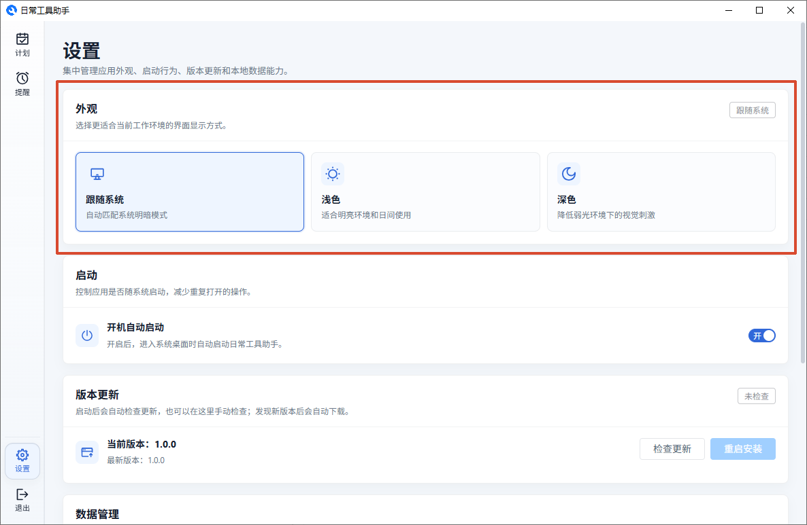
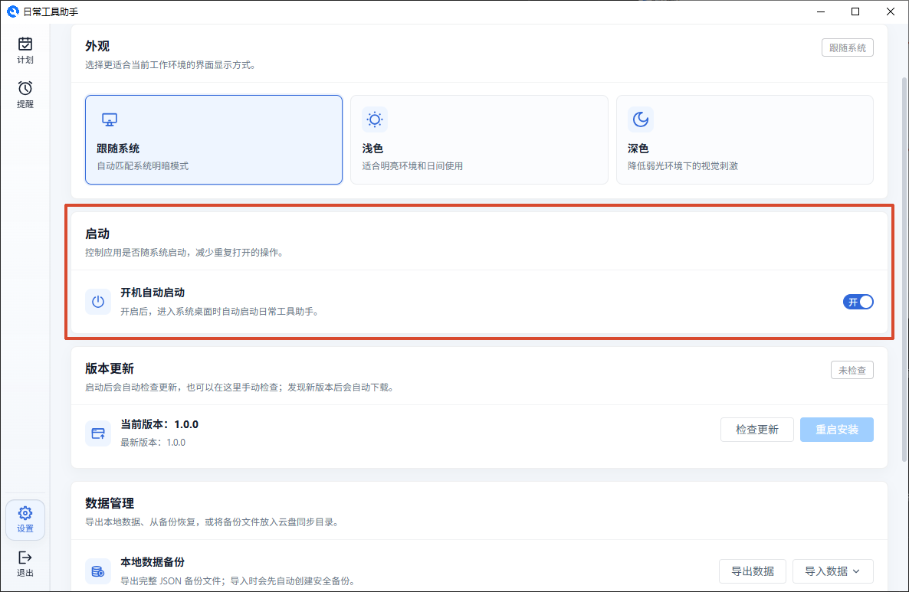
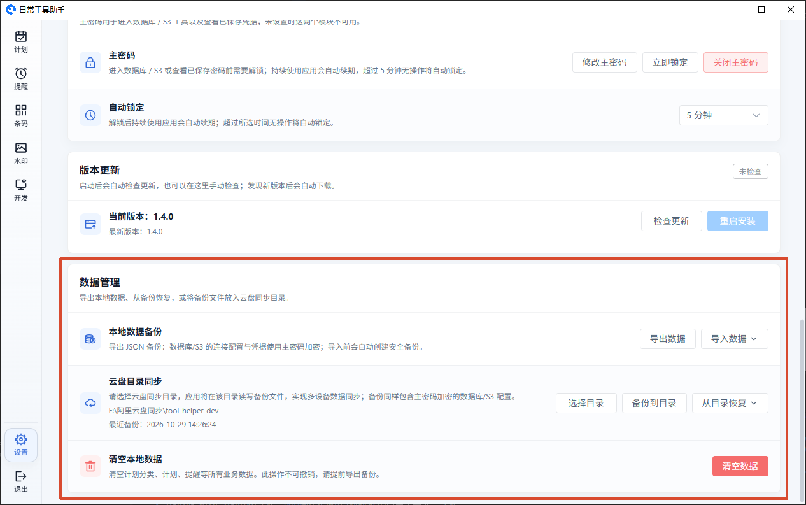
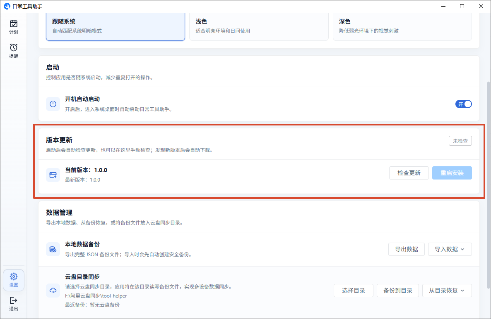

# 设置

## 外观

三种主题可选：

- **跟随系统** — 自动和系统的浅色/深色模式保持一致
- **浅色模式** — 浅灰页面背景
- **深色模式** — 深色背景，适合暗光环境

切换即时生效，不需要重启。

## 启动

- **开机自动启动** — 开启后登录系统时会自动运行应用

## 数据管理

**导出数据：** 将你的所有计划、提醒等数据保存为一个 JSON 文件，可以存到安全位置。

**导入数据：**

| 模式     | 效果                           |
| -------- | ------------------------------ |
| 合并导入 | 保留已有数据，加入新数据       |
| 覆盖导入 | 清空所有数据，替换为导入的文件 |

> 不管哪种方式，导入前都会自动帮你备份一份当前数据。

**云盘同步：** 如果你在多台电脑上用，可以用这个方法：

1. **选择目录** — 选一个云盘（如 OneDrive）的本地文件夹
2. **备份到目录** — 把当前数据存一份到那里
3. **从目录恢复** — 从文件夹里的最新备份恢复到这台电脑

**清空本地数据：** 将你的所有计划、提醒等数据全部清空。

## 版本更新

- 启动时会自动检查有没有新版本
- 也可以手动点击"检查更新"
- 发现新版本会自动下载，下载完成后点"重启安装"完成更新

---

[返回主文档](../README.md)
