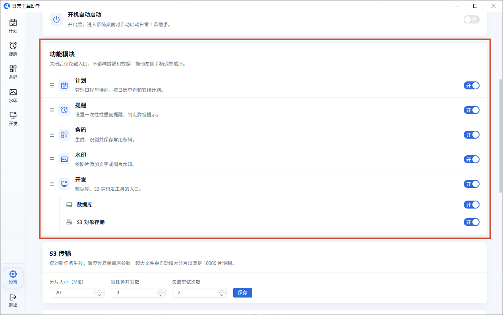
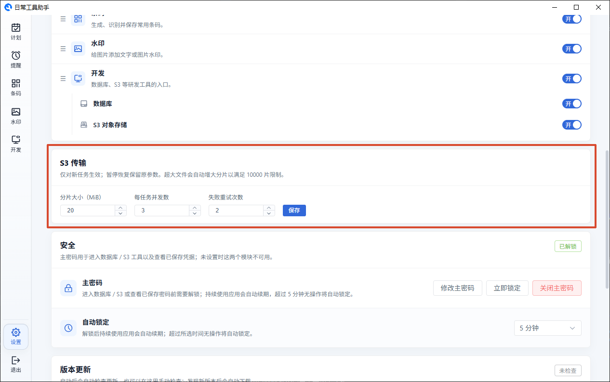
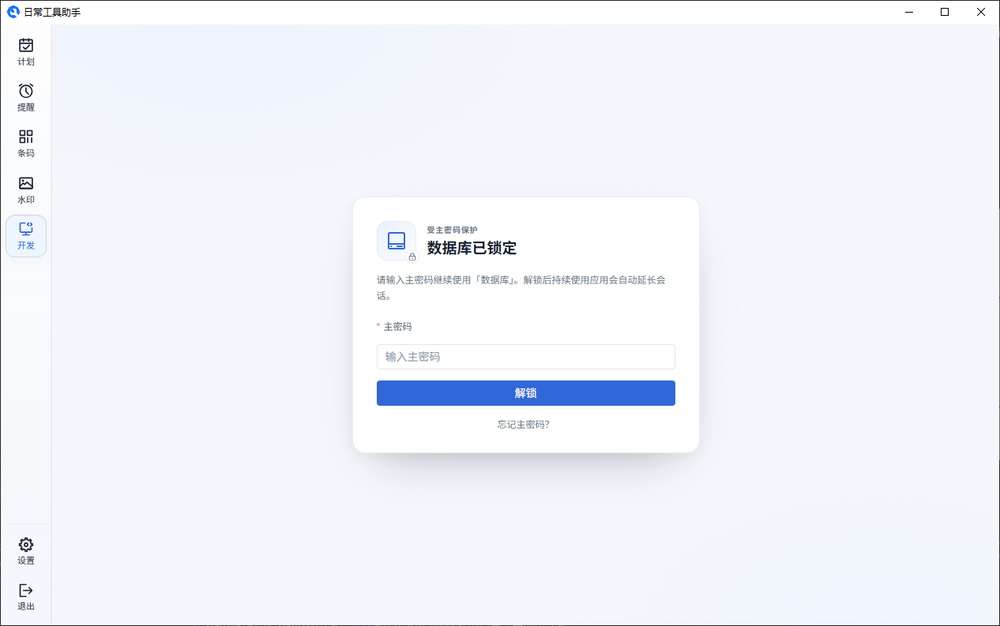
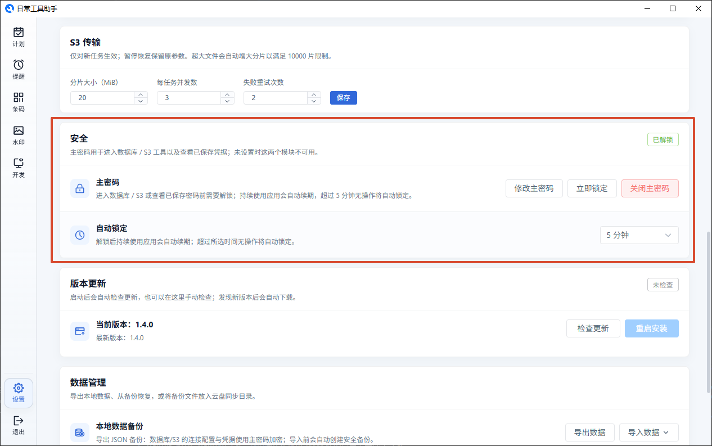

# 设置

设置页集中管理应用外观、启动行为、功能模块、S3 传输参数、主密码、版本更新和本地数据能力。

## 外观

三种主题可选：

- **跟随系统** — 自动和系统的浅色/深色模式保持一致
- **浅色模式** — 浅灰页面背景
- **深色模式** — 深色背景，适合暗光环境

切换即时生效，不需要重启。

## 启动

- **开机自动启动** — 开启后登录系统时会自动运行应用

## 功能模块

可以按自己的使用习惯隐藏不需要的入口：

- 顶层可控制 **计划 / 提醒 / 条码 / 水印 / 开发**，关闭后只隐藏侧边栏入口
- 展开「开发」后可单独关闭 **数据库 / S3 对象存储**；关闭「开发」时子项会暂时置灰，重新打开后恢复原来的选择
- 拖动顶层左侧的「☰」手柄即可调整侧边栏顺序，松手立即保存；隐藏的模块也保留在原位置
- 应用启动或返回首页时会进入第一个可见模块；全部模块都隐藏时进入设置页

> 隐藏只影响入口显示，提醒调度、弹窗和已有数据都不会被删除。

## S3 传输

调整对象存储上传、下载与跨连接复制的默认参数：

- **分片大小** — 5 至 512 MiB，默认 8 MiB
- **每任务并发数** — 1 至 16，默认 3
- **失败重试次数** — 0 至 5，默认 2

参数只对新建任务生效；暂停后恢复的任务会沿用创建时的设置。超大文件会自动增大分片，以满足 10000 片的上传限制。

## 安全

数据库与 S3 模块受主密码保护。首次进入任一模块时需要先设置主密码，之后每次进入或空闲超时都需要解锁。

首次进入时会在模块内显示主密码设置 / 解锁卡片：

- **设置主密码** — 至少 6 位；同时选择自动锁定时长
- **修改 / 关闭主密码** — 需要输入当前主密码；关闭后，下次进入数据库或 S3 时会要求重新设置
- **自动锁定** — 可选 5 / 10 / 15 / 30 分钟；持续使用应用会自动续期，超过所选时间无操作后重新锁定
- **立即锁定** — 也可随时按 `Ctrl+Alt+L` 锁定当前会话

主密码未解锁时，已保存的数据库密码、SSH 密码、私钥口令等敏感信息会保持锁定状态；编辑连接时需要先解锁主密码才能查看或修改。连续 5 次输错主密码会锁定 30 秒。

主密码只用于控制模块访问和备份加密，不会对每个对象或数据库内容做二次加密。

**忘记主密码** 时，可以在锁屏页点击"忘记主密码"按提示重置。重置会删除主密码，并清空数据库与 S3 的连接配置、凭据、查询历史和传输记录；计划、提醒等其他数据不受影响，此操作不可撤销。

## 版本更新

- 启动时会自动检查有没有新版本
- 也可以手动点击"检查更新"
- 发现新版本会自动下载，下载完成后点"重启安装"完成更新

## 数据管理

**导出数据：** 将计划、提醒、条码等数据以及数据库 / S3 的完整连接配置保存为一个 JSON 文件。其中数据库 / S3 的连接配置与凭据使用主密码加密，导出前需要先设置并校验主密码。

**导入数据：**

| 模式     | 效果                           |
| -------- | ------------------------------ |
| 合并导入 | 保留已有数据，加入新数据       |
| 覆盖导入 | 清空所有数据，替换为导入的文件 |

- 如果备份包含加密的数据库 / S3 配置，需要输入导出时使用的主密码；没有加密配置时可以留空
- 密码错误或配置损坏时不会改动本地数据
- 覆盖导入完整配置时，会先清空本机的数据库 / S3 连接与记录，再写入备份内容
- 导入结果会显示恢复的数据库 / S3 连接数量

> 不管哪种方式，导入前都会自动帮你备份一份当前数据。

**云盘同步：** 如果你在多台电脑上用，可以用这个方法：

1. **选择目录** — 选一个云盘（如 OneDrive）的本地文件夹
2. **备份到目录** — 把当前数据存一份到那里，同样需要主密码
3. **从目录恢复** — 从文件夹里的最新备份恢复到这台电脑，按提示输入备份密码

**清空本地数据：** 将计划、提醒等数据全部清空，同时清除数据库 / S3 的连接、凭据与记录，以及已设置的主密码。

---

[返回主文档](../README.md)
