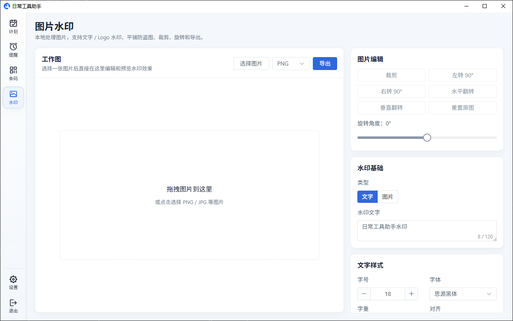
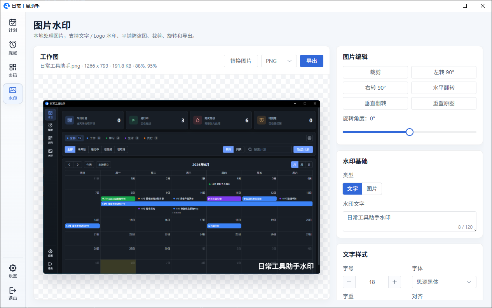
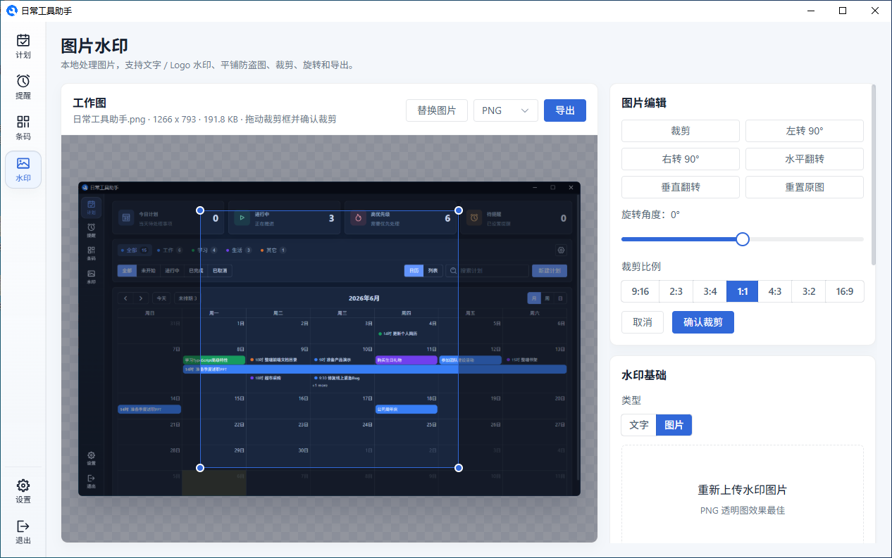
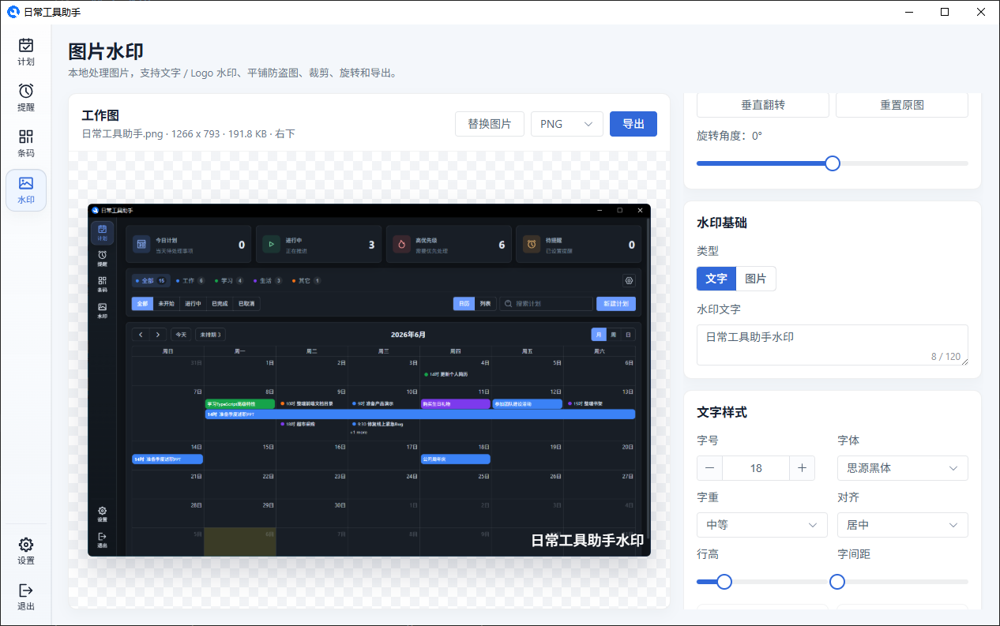
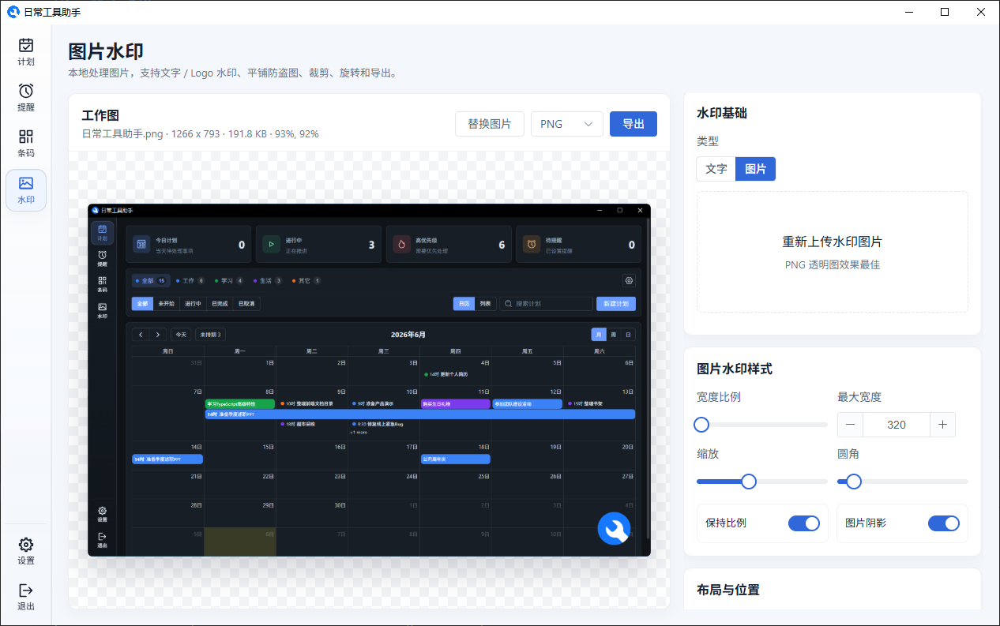
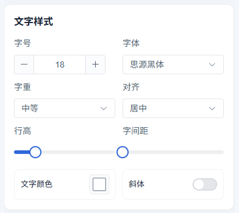
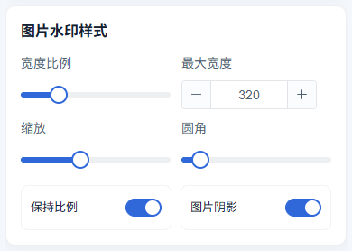
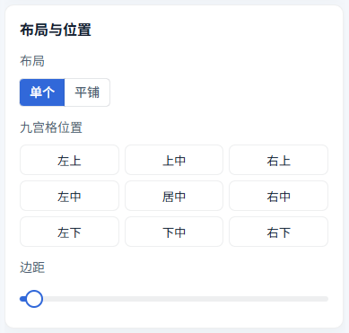
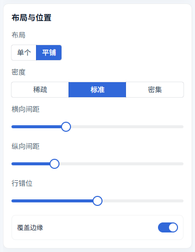
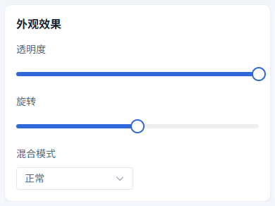

# 图片水印

水印页用于在本地给图片添加文字水印或图片/Logo 水印。原图、水印图片和导出结果都只在本地处理，不会上传到云端。

水印工作台分为左侧预览区和右侧设置区：

- **预览区** — 上传原图后实时查看水印效果，单个水印可以直接拖拽调整位置
- **设置区** — 调整图片编辑、水印内容、样式、布局和导出参数

## 上传图片与导出

进入水印页后，可以将图片拖拽到工作区，也可以点击"选择图片"从本地选择 PNG、JPG 等图片文件。
上传图片后，页面会显示图片名称、尺寸和文件大小。设置完成后，在预览区右上角选择导出格式，再点击"导出"保存到本地。

- **PNG** — 适合需要保留高质量或透明效果的图片
- **JPG** — 适合照片类图片，文件体积通常更小

## 图片编辑

右侧"图片编辑"区域可以在加水印前先调整原图。

支持的编辑操作包括：

- **裁剪** — 开启裁剪框后拖拽调整范围，再点击"确认裁剪"
- **裁剪比例** — 裁剪时可选择 9:16、2:3、3:4、1:1、4:3、3:2、16:9 等固定比例
- **左转 / 右转 90°** — 快速旋转图片方向
- **旋转角度** — 通过滑块设置 -180° 到 180° 的自定义旋转
- **水平翻转 / 垂直翻转** — 镜像调整图片方向
- **重置原图** — 清除裁剪、旋转和翻转，恢复到上传后的原始状态

## 水印基础

在"水印基础"区域选择水印类型。

- **文字** — 输入自定义水印文字，适合添加姓名、版权、用途说明或时间标记
  
- **图片** — 上传 Logo 或水印图，透明 PNG 效果更好
  

文字水印支持多行内容，图片水印可以随时重新上传替换。

## 文字水印样式

选择"文字"类型后，可以在"文字样式"区域调整文字外观。

常用配置包括：

- **字号、字体、字重、斜体** — 控制文字基础形态
- **对齐、行高、字间距** — 调整多行文字的排版效果
- **文字颜色** — 支持透明度，页面会根据图片亮度推荐更清晰的默认颜色
- **描边** — 给文字增加外轮廓，提升复杂背景上的可读性
- **阴影** — 增加阴影颜色、模糊和偏移，让文字更有层次
- **背景** — 给文字增加半透明背景、圆角和内边距，适合浅色或花纹较多的图片

## 图片水印样式

选择"图片"类型后，可以在"图片水印样式"区域调整 Logo 或水印图。

可配置内容包括：

- **宽度比例** — 按原图宽度设置水印图片占比
- **最大宽度** — 限制水印图片在大图上的最大显示宽度
- **缩放** — 在当前比例基础上继续放大或缩小
- **圆角** — 给水印图片增加圆角
- **保持比例** — 避免水印图片被拉伸变形
- **图片阴影** — 给 Logo 增加投影效果

## 布局与位置

在"布局与位置"区域可以选择单个水印或平铺水印。

**单个水印**适合在角落放置 Logo 或版权文字：

- 通过九宫格选择左上、上中、右上、左中、居中、右中、左下、下中、右下位置
- 通过"边距"调整水印与图片边缘的距离
- 在预览区直接拖拽水印，可以调整为自定义位置

**平铺水印**适合做防盗图或批量素材标记：

- **密度** — 可选择稀疏、标准或密集
- **横向间距 / 纵向间距** — 调整每个水印之间的距离
- **行错位** — 让相邻行错开，减少机械重复感
- **边缘覆盖** — 让水印覆盖到图片边缘，减少被裁掉水印的风险

## 通用效果

无论文字水印还是图片水印，都可以继续调整通用效果。

- **透明度** — 控制水印显眼程度，数值越低越淡
- **缩放** — 控制水印整体大小
- **旋转** — 让水印倾斜显示，平铺防盗图常用轻微旋转
- **混合模式** — 支持正常、正片叠底、叠加、柔光等效果，可根据图片明暗选择更自然的融合方式

调整参数后，左侧预览会自动刷新。导出时会按当前预览效果生成最终图片。

---

[返回主文档](../snapshot.md)
